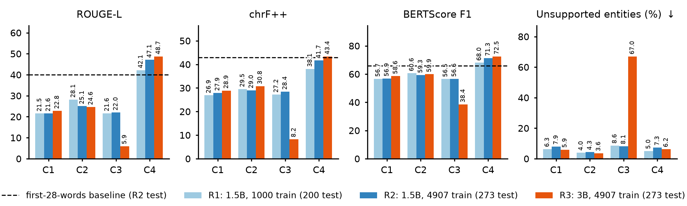

# Fine-Tuning vs. Prompt Engineering for Turkish News Summarization

How far can prompting take a small LLM on Turkish news summarization, and what does a cheap QLoRA fine-tune add?
I compare four conditions on **Qwen2.5-1.5B-Instruct** (4-bit), evaluated on the full test split (273 articles).

| | Condition | |
|---|---|---|
| C1 | Zero-shot | A single instruction: *"Aşağıdaki haber metnini 1-2 cümle ile anlaşılır şekilde özetle:"* |
| C2 | Few-shot | 3 solved examples from the training split |
| C3 | Persona + CoT | "Expert news editor", a short analysis, then the final summary |
| C4 | QLoRA | LoRA (r=16) trained on 4907 article–summary pairs, prompted like C1 |

🤗 Trained adapter: [karabunar/qwen2.5-1.5b-turkish-news-summarization-qlora](https://huggingface.co/karabunar/qwen2.5-1.5b-turkish-news-summarization-qlora)

## Results

| Condition | ROUGE-1 | ROUGE-2 | ROUGE-L | chrF++ | BERTScore-F1 |
|---|---|---|---|---|---|
| C1 Zero-shot | 25.24 | 13.48 | 21.57 | 27.92 | 56.89 |
| C2 Few-shot | 28.95 | 17.50 | 25.06 | 28.99 | 59.32 |
| C3 Persona + CoT | 25.80 | 14.92 | 22.02 | 28.42 | 56.63 |
| **C4 QLoRA** | **48.62** | **41.74** | **47.12** | **41.70** | **71.34** |
| *First-28-words baseline* | *43.61* | *36.18* | *40.07* | *42.92* | *65.87* |



- **Fine-tuning wins by a wide margin:** +22 to +26 ROUGE-L over every prompting condition.
- **CoT does not help a 1.5B model:** C3 vs. C1 is +0.5 ROUGE-L, not significant. On the 3B model, CoT collapses because the analysis uses up the token budget.
- **Part of the gain is style imitation:** the fine-tuned model copies the article's lead, much like the references do. A trivial first-28-words baseline already reaches 40.1 ROUGE-L.
- **More data and a bigger model help, modestly:** going from 1000 to 4907 training samples adds +5.5 ROUGE-L. Going from 1.5B to 3B adds +1.6.
- **Merging a QLoRA adapter is not free:** the unmerged adapter makes decoding 33 % slower. Merging it into the 4-bit base restores the speed but costs 20 ROUGE-L points.

The full error analysis (entities, copying, significance tests, leakage check, ablations) is in [`ERROR_ANALYSIS.md`](ERROR_ANALYSIS.md).

## Quick start

**Use the adapter**
```python
import torch
from peft import PeftModel
from transformers import AutoModelForCausalLM, AutoTokenizer, BitsAndBytesConfig

base = "Qwen/Qwen2.5-1.5B-Instruct"
bnb = BitsAndBytesConfig(load_in_4bit=True, bnb_4bit_quant_type="nf4",
                         bnb_4bit_use_double_quant=True, bnb_4bit_compute_dtype=torch.bfloat16)
tok = AutoTokenizer.from_pretrained(base)
model = AutoModelForCausalLM.from_pretrained(base, quantization_config=bnb, device_map="auto")
model = PeftModel.from_pretrained(model, "karabunar/qwen2.5-1.5b-turkish-news-summarization-qlora")

article = "..."  # Turkish news text
messages = [{"role": "user", "content": f"Aşağıdaki haber metnini 1-2 cümle ile anlaşılır şekilde özetle:\n\n{article}"}]
inputs = tok.apply_chat_template(messages, add_generation_prompt=True, return_tensors="pt").to(model.device)
out = model.generate(inputs, max_new_tokens=80, do_sample=False)
print(tok.decode(out[0, inputs.shape[1]:], skip_special_tokens=True))
```

**Reproduce the experiments** (needs an NVIDIA GPU with bf16 support, 16 GB was used)
```bash
docker compose build
docker compose run --rm summarizer bash
bash run_full.sh            # tests -> C1-C3 -> QLoRA training -> C4 -> evaluation and analysis
```
You can check the scores without a GPU by recomputing them from the saved predictions: `python -m scripts.evaluate_predictions`.

Run details, logs, reproducibility notes and the extra experiments are in [`docs/EXPERIMENTS.md`](docs/EXPERIMENTS.md).

## Project structure
```
domain/          prompts, output parser, metrics
application/     use cases: prompting, training, export
infrastructure/  Hugging Face model adapter (4-bit + QLoRA), dataset, CSV export
scripts/         analysis, baselines, ablations, inference-cost benchmarks
config/          all prompts and hyperparameters (checked against the code by tests)
outputs/         main-run predictions, metrics and logs
experiments/     earlier runs, the 1000-sample run and the 3B-model run
tests/           pytest suite
```

## License
Code under the [MIT License](LICENSE).
Data: [`ahmetyaylalioglu/turkish-news-summarization-collection`](https://huggingface.co/datasets/ahmetyaylalioglu/turkish-news-summarization-collection) (CC BY 4.0). The prediction CSVs contain its news texts.
Models: [Qwen2.5-1.5B-Instruct](https://huggingface.co/Qwen/Qwen2.5-1.5B-Instruct) (Apache 2.0), [Qwen2.5-3B-Instruct](https://huggingface.co/Qwen/Qwen2.5-3B-Instruct) (Qwen Research License), and [dbmdz/bert-base-turkish-cased](https://huggingface.co/dbmdz/bert-base-turkish-cased) for BERTScore.
